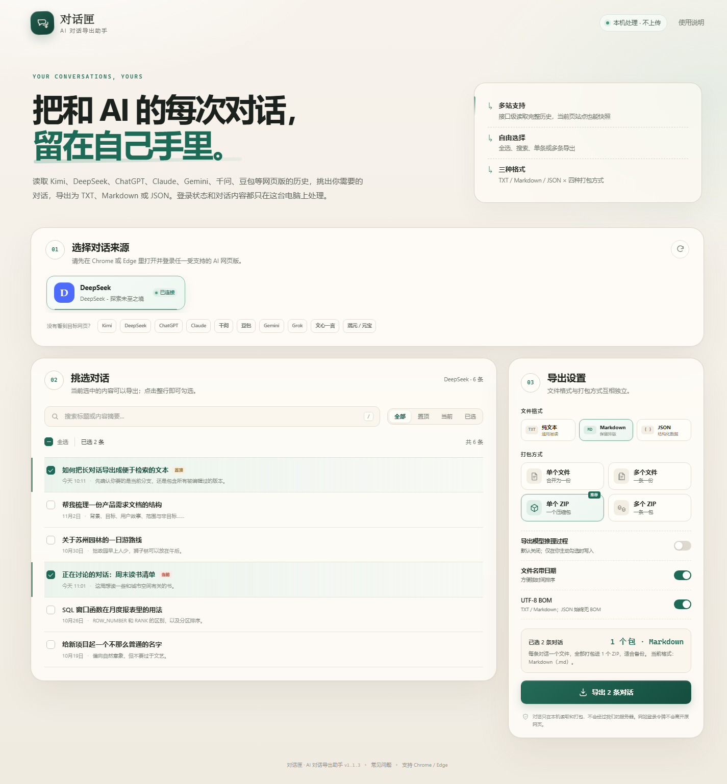

# 对话匣 · AI 对话导出助手

把多个网页版 AI 的历史对话，按需导出为 **TXT、Markdown 或 JSON**；可以选择合并成单个文件、拆成多个文件，或打包成单个 / 多个 ZIP。所有数据只在本机读取、打包和保存，不上传服务器。



## 为什么是浏览器插件，而不是 .exe？

这个需求的关键不是“做一个桌面窗口”，而是**拿到网页版账号里的完整历史记录**。浏览器扩展可以直接使用你当前网页的登录态，在同一页面内调用网站自己的接口，既不需要你输入密码，也不需要破解浏览器的加密 Cookie。

一个独立的 .exe 反而会遇到三个问题：

1. 它拿不到浏览器里的网页登录态；
2. 它无法可靠读取浏览器 localStorage / IndexedDB；
3. 如果强行导出 Cookie 或注入浏览器，安全风险和被杀毒软件误报的概率都会很高。

所以这个版本采用 **Chrome / Edge 的 Manifest V3 扩展**实现，在 Windows 上直接可用。原生 Windows App 的本地数据库不在读取范围内，详见下文“能力边界”。

## 交付文件

- `AI对话导出助手/`：可直接“加载已解压的扩展程序”的完整目录
- `AI对话导出助手-v1.1.3.zip`：打包后的同一目录，方便拷贝和备份
- `使用说明.md`：本文件
- `预览.png`：界面预览图
- `SHA256.txt`：发布 ZIP 的校验值

## 支持的网站

| 网站 | 能力 | 说明 |
| --- | --- | --- |
| DeepSeek `chat.deepseek.com` | 全量 | 全部历史、当前分支、思考过程、置顶 |
| Kimi `www.kimi.com` | 全量 | 全部历史、消息正文、思考过程、当前对话 |
| ChatGPT `chatgpt.com` | 实验 | 会话列表与当前分支正文 |
| Claude `claude.ai` | 实验 | 组织下的会话列表与正文 |
| Gemini `gemini.google.com` | 实验 | 通过内部 batchexecute 接口读取历史 |
| 千问 / Qwen `qianwen.com` / `chat.qwen.ai` | 实验 | 会话列表（含置顶、分页）、历史消息 |
| 豆包 `www.doubao.com` | 实验 | 普通对话、智能体会话 |
| Grok `grok.com` | 当前页 | 导出当前打开对话中已加载的消息 |
| 文心一言 `yiyan.baidu.com` | 当前页 | 导出当前打开对话中已加载的消息 |
| 混元 / 腾讯元宝 `hunyuan.tencent.com` / `yuanbao.tencent.com` | 当前页 | 导出当前打开对话中已加载的消息 |

> “全量/实验”表示扩展通过网站历史接口读取；“当前页”表示只读取当前页面上已经加载出的消息。当前页模式请先滚动到对话最早一条，再执行导出。

## 输出格式与打包方式

格式和打包方式互相独立，共 **12 种组合**：

| 格式 | 内容 |
| --- | --- |
| TXT | 通用纯文本，带元信息和分隔线，兼容记事本 |
| Markdown (.md) | 保留标题、列表、代码块等 Markdown 排版 |
| JSON (.json) | 结构化字段：会话、时间、角色、正文、思考过程等 |

| 打包方式 | 结果 |
| --- | --- |
| 单个文件 | 所有选中对话合并成 1 个文件；JSON 为 bundle |
| 多个文件 | 每条对话 1 个文件，放进同一文件夹 |
| 单个 ZIP | 每条对话 1 个文件，全部打包进 1 个 ZIP |
| 多个 ZIP | 每条对话单独 1 个 ZIP |

示例：

- TXT + 单个文件 → `AI对话导出_DeepSeek_12条_20261104_103000.txt`
- Markdown + 多个文件 → 文件夹内 `001_2026-11-04_标题.md`、`002_...md`
- JSON + 单个 ZIP → `AI对话导出_DeepSeek_12条_20261104_103000.zip`，内含 12 个会话 JSON
- TXT + 多个 ZIP → 每条对话一个 `.zip`，每个 ZIP 内含对应 `.txt`

JSON 会话结构示例：

```json
{
  "schema": "aiexport.conversation.v1",
  "conversation": {
    "id": "会话 ID",
    "title": "会话标题",
    "source": { "id": "deepseek", "name": "DeepSeek" },
    "url": "https://...",
    "created_at": "2026-11-04T02:30:00.000Z",
    "updated_at": "2026-11-04T02:31:00.000Z",
    "message_count": 4,
    "messages": [
      { "role": "user", "text": "你好", "created_at": "..." },
      { "role": "assistant", "text": "你好！", "thinking": "..." }
    ]
  }
}
```

## 安装

### Chrome

1. 将 `AI对话导出助手` 文件夹放在不会被删除的位置，例如 `D:\AI对话导出\AI对话导出助手`。
2. 地址栏打开 `chrome://extensions`。
3. 打开右上角的 **开发者模式**。
4. 点击 **加载已解压的扩展程序**，选择 `AI对话导出助手` 文件夹。
5. 建议点击扩展卡片上的图钉，把它固定到工具栏。

### Edge

1. 地址栏打开 `edge://extensions`。
2. 打开左侧的 **开发人员模式**。
3. 点击 **加载解压缩的扩展**，选择 `AI对话导出助手` 文件夹。
4. 把扩展固定到工具栏。

> 如果拿到的是 ZIP，请先解压；不要直接选择 ZIP 文件。
>
> 安装或更新扩展后，**之前已经打开的 AI 网页需要刷新一次**，内容脚本才会更新。

## 使用

1. 在 Chrome / Edge 中打开并登录一个受支持的 AI 网页版。
2. 点击工具栏「对话匣」图标打开工作台。
3. 在「01 选择对话来源」中选择对应标签页，扩展会读取历史。
4. 在「02 挑选对话」中搜索、筛选、全选或逐条勾选。
5. 在「03 导出设置」中选择 **文件格式**（TXT / Markdown / JSON）与 **打包方式**（单个文件 / 多个文件 / 单个 ZIP / 多个 ZIP）。
6. 点击「导出 N 条对话」，文件会保存到浏览器默认下载目录下的 `AI对话导出/网站名/`。

可选项：

- **导出模型推理过程**：默认关闭。只有主动勾选后，才会把接口返回的 reasoning / think 字段写入 TXT / Markdown / JSON；回答正文始终导出。
- **文件名带日期**：用会话更新时间作为文件名前缀。
- **UTF-8 BOM**：仅用于 TXT / Markdown；JSON 始终无 BOM，避免解析问题。

## 能力边界

- **只支持网页版**：读取网页账号在网站上保存的记录。原生 Windows App 的本地数据库、手机 App 的本地缓存不在范围内。若 App 对话已同步到网页版，可以读取。
- **当前页模式**（Grok、文心一言、混元 / 元宝）只读取页面上已加载的消息，不是账号全量历史。长对话请先滚动加载完整，再导出。
- **实验站点**（ChatGPT、Claude、Gemini、千问、豆包）使用网站内部接口；网站改版、风控或登录策略变化时可能暂时失效。
- 不绕过登录、付费墙或权限限制。必须先在浏览器中登录，且网页本身能打开这些历史。
- 附件目前只记录文件名或可见链接，不下载图片 / PDF / 文件本体。
- 被编辑 / 重新生成替换掉的旧分支默认不导出；文件头会注明隐藏了多少条。不同站点的分支结构支持程度不同。
- 部分站点（如 Gemini）内部接口不稳定，失败时会提示；部分站点会自动降级为“当前页”快照，并在会话列表显示提示。

## 隐私与安全

- 扩展没有后端服务，没有把对话发到任何第三方域名。
- 登录令牌只在 AI 网页的内容脚本内存中读取，用于向该网站的同源接口发起请求；**不会发送到导出工作台，也不会写入扩展存储**。
- 扩展不读取、不存储账号密码。
- 导出过程完全在浏览器和本机文件系统中完成。
- 扩展只做读取：不删除、不修改、不发送网站上的对话。
- 导出的 TXT / Markdown / JSON / ZIP 都是标准文件，不加密、不绑定账号，请自行保管。

## 常见问题

### 点击图标没有反应

在 `chrome://extensions` / `edge://extensions` 确认扩展已启用；点击浏览器工具栏上的图标，或从拼图菜单固定“对话匣”。更新扩展后刷新工作台和 AI 网页。

### 提示“需要重新登录”或“登录状态已失效”

打开对应网站，刷新页面，确认网页里能看到历史记录；回到工作台点「重试」。扩展不会读取或保存密码。DeepSeek 的登录令牌在 localStorage 的 `userToken`；Kimi 在 `access_token` 或 `kimi-auth` Cookie；其他站点主要依赖网页 Cookie。

### 历史列表没有读全

账号会话特别多、网络中断或网站限流时可能只读到了一部分；等待片刻后重试，建议分批导出。对于“当前页”站点，列表只有当前对话，这是预期行为。

### 为什么 Grok / 文心一言 / 混元只有当前页？

这几个站点目前没有稳定、可复用的完整历史接口，扩展改用页面快照：只导出当前打开的对话中已经加载出来的消息。完整历史适配会在接口稳定后补上。请先滚动到最早一条再导出。

### JSON 和 Markdown 怎么选？

Markdown 适合阅读和继续编辑，保留标题、列表、代码块等排版；JSON 适合导入其他工具、做二次分析，包含会话 ID、时间、角色、正文、思考过程等字段。

### 选择多个文件后浏览器提示下载多个文件？

这是正常保护，允许该扩展下载多个文件即可。数量很多时建议使用「单个 ZIP」。

### 网站改版后读不出来

AI 网站的内部接口会变化。请更新扩展版本；原始对话仍保存在你的账号里，不会因为导出失败而丢失。错误提示里通常会给出刷新、重试或当前页替代方案。

### 是否支持 Firefox？

当前版本是 Chromium Manifest V3 扩展，面向 Chrome / Edge；Firefox 需要单独适配。

## 技术说明（给维护者）

- `manifest.json`：权限、内容脚本匹配规则
- `background.js`：点击图标打开工作台、安装时打开说明页
- `content.js`：页面消息桥；读取登录态、调用同源接口、回传会话
- `lib/core.js`：站点适配器、TXT / Markdown / JSON 序列化、ZIP 写入器
- `dashboard.*`：工作台 UI
- `help.*`：内置使用说明

已实现的主要接口：

- DeepSeek：`/api/v0/chat_session/fetch_page`、`/api/v0/chat/history_messages`
- Kimi：`/apiv2/kimi.gateway.chat.v1.ChatService/ListChats`、`/ListMessages`
- ChatGPT：`/api/auth/session`、`/backend-api/conversations`、`/backend-api/conversation/{id}`
- Claude：`/api/organizations`、`/api/organizations/{org}/chat_conversations`
- Gemini：`/_/BardChatUi/data/batchexecute` 的 `MaZiqc` / `hNvQHb`
- 千问：`/api/v2/session/page/list`、`/api/v1/session/msg/list`
- 豆包：`/im/chain/recent_conv`、`/im/chain/single`
- Grok / 文心一言 / 混元：DOM 当前页提取

### 本地验证

- 12 种格式 × 打包组合的核心序列化与归档逻辑有单元测试
- 用本地模拟接口跑通 DeepSeek 的 TXT 单个/多个、JSON 单个/ZIP、Markdown 多个等端到端下载
- ZIP 通过 Python `zipfile.testzip()` 校验；中文文件名、UTF-8 BOM、JSON 无 BOM 均验证
- 下载文件名、中文子目录、`chrome.downloads` 完成状态在 Edge 156 下验证
- 桌面 1440px 与移动 390px 宽度无横向溢出
- 真实登录账号的接口兼容性需要你在本机验证；接口失败时请提供页面提示

## 1.1.3 更新

- 千问历史消息请求改用官网默认的 §page_size=5§，避免超大分页返回不完整的问答记录。
- 千问回答解析增加对字符串/数组形式的 §answers§、§response_messages§、§qwen_response_messages§ 等字段的兼容。
- 千问在首轮没有拿到回答时，会再读取 §/api/v1/session/get§ 的最新位置并重试；仍在当前会话页时，会从页面 DOM 补全回答。
- 如仍只识别到提问，导出会保留明确的失败提示，不会生成缺少回答的文件。

## 1.1.2 更新

- 修复部分站点只导出提问、没有导出模型回答的问题：改进 Claude、ChatGPT、Gemini、千问、豆包的助手消息解析，并修复当前页模式只取到提问节点的问题。
- Gemini 现在会读取回答正文和 thoughts 推理内容；Qwen 会读取回答 cards 及 reasoning；Claude 会读取 thinking；ChatGPT 会读取 reasoning summary；豆包会识别思考块。
- 「导出模型推理过程」改为**默认关闭**、由用户手动勾选；回答正文始终导出，TXT / Markdown / JSON 都遵循该选择。
- 如果站点结构异常，只识别到提问、没有识别到回答，导出会明确提示该条失败，而不是悄悄生成一份只有提问的文件。
- 当前页模式会同时收集提问和回答节点；识别不到角色时自动追加整页文字快照并在文件头提示。

## 1.1.1 更新

- 修复千问（www.qianwen.com）历史读取：改用当前官网的 `chat2-api.qianwen.com` v2 会话接口，补齐 `X-Platform`、`X-XSRF-TOKEN`、`X-DeviceId` 及公共查询参数。
- 修复千问列表只读第一页的问题：现在会读取置顶会话并按 `next_token` 翻完普通会话。
- 修复千问消息结构解析：同时支持 `questions/answers`（cards）、`request_messages/qwen_response_messages` 等返回形式，并按 `pos`/时间翻页。
- 新增 `chat.qwen.ai` 国际站的 `/api/v2/chats` 适配。
- 修复历史列表为空时警告不显示的问题。

## 版本

1.1.3 · 2026-11-04
